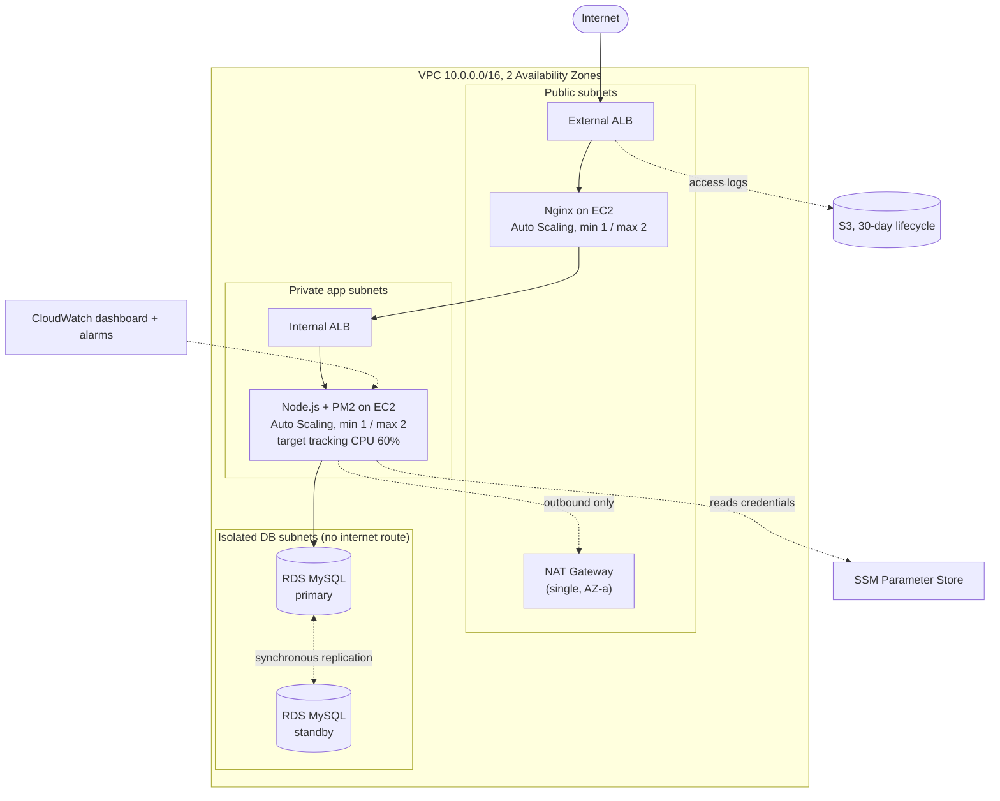

# Meridian: Highly Available, Self-Healing Three-Tier Platform on AWS

A three-tier web platform built by hand in the AWS console (`us-east-1`), then stress-tested and documented. The goal was to understand how each production piece behaves and fails, not just to get it running.

**Stack:** Nginx · Node.js (PM2 cluster mode) · RDS MySQL 8 Multi-AZ · VPC · ALB · EC2 Auto Scaling · SSM · S3 · CloudWatch · IAM

## Architecture



Security groups form a chain, so each tier accepts traffic only from the tier directly above it:
`sg-alb-external → sg-web → sg-alb-internal → sg-app → sg-db`

The full diagram is in [`docs/architecture.drawio`](docs/architecture.drawio). Open it at [app.diagrams.net](https://app.diagrams.net) (File → Open from → Device); edges animate there.

## Design decisions

- **No SSH, no key pairs, no bastion.** All instance access goes through SSM Session Manager.
- **Credentials live in SSM Parameter Store**, read at app start. The app role's inline IAM policy is scoped to `/3tier-app/db/*`, not every parameter in the account.
- **Database in isolated subnets** with no route to the internet at all.
- **Internal ALB between web and app tiers**, so the app tier is never reachable from outside the VPC.
- **ALB access logs to S3** with a 30-day lifecycle rule.

## Results

| Test | Result |
|---|---|
| Forced RDS Multi-AZ failover (Reboot with Failover) | About 15 s application-level downtime, one connection error, automatic recovery with no restart. Polled every 500 ms through the full request chain. |
| Auto Scaling under load | Scale-out 1 → 2 at 17:44Z (CPU peaked around 80%). Scale-in 2 → 1 at 18:01Z once load stopped, fully automatic, completed in under 6 minutes. |

Both are written up in [`docs/build-log.md`](docs/build-log.md) with timestamps.

## What went wrong (and why it's the useful part)

Eight real failures were diagnosed and fixed during the build, each documented with symptom, root cause, fix and takeaway. A few examples:

- **Instance replacement loop:** the ASG health-check grace period was shorter than boot time, so healthy-to-be instances were killed repeatedly.
- **Scaling threshold that could never trigger:** a single-threaded Node process capped total CPU near 50% on 2 vCPUs, below the 60% target. Fixed with PM2 cluster mode.
- **Load test measuring the client, not the server:** per-request connections caused `TIME_WAIT` exhaustion on the test host. Fixed with keep-alive connections from CloudShell.
- **Silent 404s through Nginx:** a trailing slash on `proxy_pass` stripped the `/api/` prefix.

The full list is in section 2 of the build log.

## Repository layout

```
.
├── README.md
├── docs/
│   ├── architecture.drawio   # editable architecture diagram
│   ├── build-log.md          # phase-by-phase build, 8 problems and root causes, test results
│   ├── runbook.md            # teardown / rebuild / verify / full decommission
│   ├── learning-plan.md      # original phased plan with cost and exam mapping
│   └── images/               # exported diagram PNG goes here
└── scripts/
    └── load-test/            # keep-alive load generator used for the scaling test
```

## Start here

| If you want to... | Read |
|---|---|
| See how it was built and what broke | [`docs/build-log.md`](docs/build-log.md) |
| Tear it down or bring it back up | [`docs/runbook.md`](docs/runbook.md) |
| Reproduce the load test | [`scripts/load-test/`](scripts/load-test/) |

## Cost control

NAT Gateway, both ALBs, running EC2 and a running RDS instance bill hourly. Everything else is free or near-free at rest. The runbook gives the exact shutdown and rebuild order so the project can sit idle between sessions at close to zero cost.

## Scope and limitations

Deliberately not built, and not claimed:

- **Route 53, ACM / HTTPS:** no registered domain. The ALB serves HTTP only.
- **WAF, CloudFront, VPC endpoints, read replicas.**
- **Single NAT Gateway** in one AZ: a cost trade-off. An AZ-a outage would cut outbound access for the private tier.
- **Health-check race under saturating load** (Problem 8): documented, not fully resolved. The proper fix is a background queue for CPU-bound work.
- **Manual console build:** no Infrastructure as Code yet.

## Next steps

1. Codify the build in Terraform or CloudFormation.
2. Register a cheap domain and complete HTTPS with ACM and Route 53.
3. Move CPU-bound work to a background queue to resolve Problem 8.
4. Add WAF on the external ALB.

## Author

Shahzaib Ahmed Khan, Software Engineer · [LinkedIn](https://www.linkedin.com/in/shahzaib-ahmed-khan-it/)
