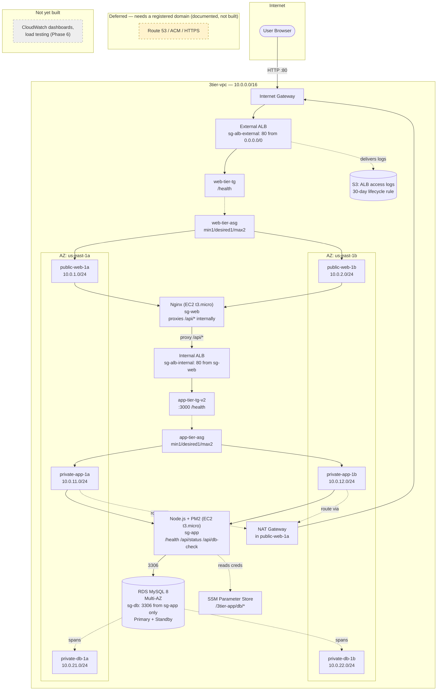
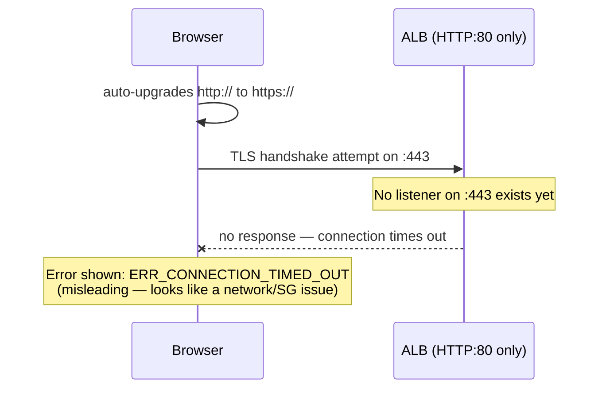
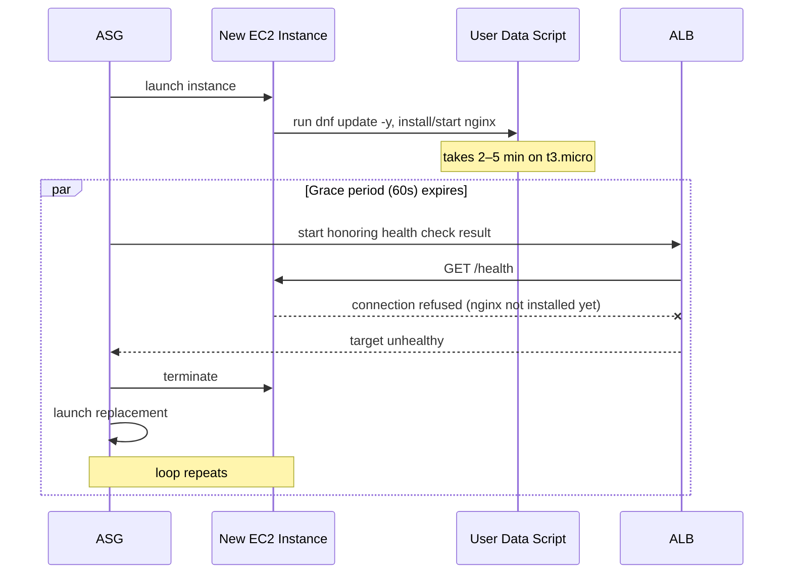

# 3-Tier AWS Architecture — Progress Log (Phase 0 → Phase 6, COMPLETE)

**Project:** Production-Ready 3-Tier AWS Architecture (SAA-C03 prep + portfolio build)
**Status as of this log:** All 6 phases complete. Core architecture fully built, monitored, load-tested, and a live Auto Scaling event (both scale-out and scale-in) captured with CloudWatch evidence. Only the domain-dependent portion of Phase 5 (ACM/HTTPS/Route 53) remains deliberately deferred — see Phase 5 notes.
**Region:** us-east-1

> This is a living document — each phase's build notes and problems get appended here rather than split into separate files, so the whole project reads as one chronological log by the end.

---

## 1. What's Been Built So Far

### Phase 0 — Account Setup
- IAM admin user created (root account no longer used day-to-day), MFA enabled.
- AWS Budgets configured with $10 / $25 alert thresholds.
- AWS CLI v2 configured locally against the IAM admin user.

### Phase 1 — VPC & Networking Foundation
- VPC `3tier-vpc` — CIDR `10.0.0.0/16`
- 6 subnets across 2 AZs (public web, private app, private db — isolated for later phases)
- Internet Gateway attached, public route table routes `0.0.0.0/0 → IGW`
- Security group shells created: `sg-alb-external`, `sg-web`, `sg-alb-internal`, `sg-app`, `sg-db`

### Phase 2 — Web Tier (Nginx + Auto Scaling + External ALB)
- `EC2-Web-Tier-Role` IAM role with `AmazonSSMManagedInstanceCore` — SSM Session Manager access, no SSH/key pairs, no bastion host
- `sg-web`: inbound 80 from `sg-alb-external` only (not open to the internet directly)
- `sg-alb-external`: inbound 80 from `0.0.0.0/0`
- Launch template `web-tier-lt`: Amazon Linux 2023, t3.micro, `EC2-Web-Tier-Role`, user data installs and starts Nginx, serves an instance-ID page and a `/health` endpoint
- Target group `web-tier-tg`: HTTP:80, health check path `/health`
- External ALB `web-tier-alb-external`: internet-facing, spans both public subnets, listener HTTP:80 → `web-tier-tg`
- Auto Scaling Group `web-tier-asg`: min 1 / desired 1 / max 2, target-tracking on 60% average CPU, ELB health checks enabled, health check grace period **300s** (tuned — see Problem #2 below)

### Phase 3 — Private Networking + App Tier (NAT Gateway, Node.js/PM2, Internal ALB)
- NAT Gateway `nat-gateway-1a` in `public-web-1a` with an Elastic IP; route added in `private-app-rt`: `0.0.0.0/0 → NAT Gateway` — single NAT Gateway (not one per AZ), a deliberate cost/HA trade-off for this learning project
- `sg-alb-internal`: inbound 80 from `sg-web` only
- `sg-app`: inbound 3000 from `sg-alb-internal` only
- `EC2-App-Tier-Role` IAM role with `AmazonSSMManagedInstanceCore` — same no-SSH pattern as the web tier
- Launch template `app-tier-lt`: Amazon Linux 2023, t3.micro, `EC2-App-Tier-Role`, user data installs Node.js and runs a minimal app (no framework, no full `dnf update -y`) under PM2, exposing `/health` and `/api/status`
- Target group `app-tier-tg-v2`: HTTP:3000, health check path `/health` (see Problem 4 — the original `app-tier-tg` was misconfigured on port 80 and was replaced)
- Internal ALB `app-tier-alb-internal`: internal scheme, spans both private-app subnets, listener HTTP:80 → `app-tier-tg-v2`
- Auto Scaling Group `app-tier-asg`: min 1 / desired 1 / max 2, target-tracking 60% CPU, health check grace period 180s (later widened to 240s in Phase 4 for the heavier DB-connected version)
- Web tier's Nginx updated (new launch template version + instance refresh) to reverse-proxy `/api/*` to the internal ALB

### Phase 4 — Database Tier (RDS MySQL Multi-AZ)
- DB subnet group `db-subnet-group` spanning the isolated `private-db-1a` / `private-db-1b` subnets (no internet route at all, not even via NAT)
- `sg-db`: inbound 3306 from `sg-app` only — the tightest SG in the architecture by design
- Credentials stored in SSM Parameter Store, not hardcoded: `/3tier-app/db/username`, `/3tier-app/db/password` (SecureString), `/3tier-app/db/name`, `/3tier-app/db/host` (added after RDS creation)
- RDS instance `three-tier-db`: MySQL 8.x, `db.t4g.micro` (swapped in for `db.t3.micro`, which wasn't offered under the Dev/Test template for this engine version/region — same burstable tier, Graviton/ARM instead of Intel, no functional difference for a MySQL client), Multi-AZ enabled, 20 GiB gp3, not publicly accessible
- `EC2-App-Tier-Role` granted a scoped inline policy: `ssm:GetParameter` limited to `/3tier-app/db/*`, plus `kms:Decrypt` for the SecureString parameter
- App tier code upgraded (new launch template version + instance refresh): added `mysql2` connection pool and the AWS SDK's SSM client, fetching all four DB parameters at startup; new `/api/db-check` endpoint runs `SELECT 1` against RDS; the HTTP server deliberately still starts even if DB initialization fails, so `/health` stays reportable to the ALB independent of DB connectivity
- **Live Multi-AZ failover tested** via RDS "Reboot with Failover" while polling `/api/db-check` every 500ms — see results below

### Phase 5 — DNS, TLS & Security Hardening (adjusted scope — no domain owned)

**Scope note:** this project doesn't have a registered domain, so the ACM certificate, HTTPS listener, and Route 53 alias record steps were deliberately **not built** rather than faked with a placeholder domain. This is documented explicitly here rather than silently skipped — see "Deferred Work" below for exactly what that would involve.

What *was* built, since it doesn't depend on owning a domain:
- S3 bucket (private, public access fully blocked) for external ALB access logs, with a bucket policy granting the region's ELB log-delivery service account write access specifically — not the EC2 roles, since the ALB writes these logs directly via an AWS-managed service identity, not through anything in the app
- Lifecycle rule expiring log objects after 30 days, keeping storage cost effectively at zero indefinitely
- Verified log delivery end-to-end (generated traffic → `.log.gz` files appeared under the expected `AWSLogs/<account-id>/...` prefix within ~10 minutes)
- IAM least-privilege pass across both EC2 roles: confirmed `EC2-Web-Tier-Role` carries only `AmazonSSMManagedInstanceCore` (AWS's own minimal SSM policy, nothing to trim), confirmed `EC2-App-Tier-Role`'s inline policy still shows the scoped `/3tier-app/db/*` resource ARN rather than a wildcard, confirmed both roles' trust policies permit only `ec2.amazonaws.com` as principal
- Enabled IAM Access Analyzer's unused-access findings for ongoing review

**Deferred work (documented, not built):** with a registered domain, this phase would add an ACM public certificate (DNS-validated), an HTTPS:443 listener on the external ALB with an HTTP→HTTPS redirect on port 80, and a Route 53 alias A record pointing the domain at the ALB. Worth noting: this would have also been the real fix for Problem 1 back in Phase 2 (the browser's silent HTTP→HTTPS upgrade) — adding genuine HTTPS support removes the root cause of that confusion rather than just working around it with `curl`.

### Phase 6 — Monitoring, Load Testing & Teardown Discipline

- CloudWatch dashboard `3tier-portfolio-dashboard`: ASG instance counts (both tiers), CPU by tier, external ALB requests/latency/5xx, RDS CPU/connections/storage
- Deliberately skipped a dedicated CloudWatch billing alarm — the Phase 0 AWS Budget alert was judged sufficient given the architecture gets torn down between sessions anyway; documented as a conscious decision, not an oversight
- Verified both ASGs' target-tracking policies already handle scale-in automatically (target tracking creates a paired `AlarmHigh`/`AlarmLow` CloudWatch alarm set per ASG — no separate scale-in configuration was needed)
- Load tested the full request chain against `/api/status` and later a purpose-built `/api/cpu-load` endpoint, iterating through three distinct client-side/application-side problems before getting a valid result (see Problems 6-8)
- **Captured a complete, genuine Auto Scaling lifecycle event** with full CloudWatch and ASG Activity evidence: scale-out triggered by the real `TargetTracking-app-tier-asg-AlarmHigh` alarm crossing 60% CPU (peaked ~80%), followed by automatic scale-in via the paired `AlarmLow` alarm once load stopped — both with exact timestamps, included below

### Current Architecture State



---

## 2. Problems Encountered & How They Were Solved

### Problem 1 — ALB DNS name gave `ERR_CONNECTION_TIMED_OUT`

**Symptom:** Browser showed a connection timeout hitting the ALB's DNS name — not a 503, a full timeout.

**Investigation path:** checked (all came back correct, in order) — `sg-alb-external` inbound rule, SG actually attached to the ALB, ALB's subnets mapped to `public-rt`, NACLs unmodified.

**Root cause:** the browser was silently upgrading `http://` to `https://` (Chrome/Firefox "always use secure connections" behavior). The ALB only had an HTTP:80 listener at this point in Phase 2 — no HTTPS:443 listener exists until Phase 5 (ACM cert). The browser's HTTPS attempt hit nothing and timed out, with no indication in the error message that HTTPS was even attempted.

**Fix:** tested with `curl.exe -v http://<alb-dns-name>` explicitly instead of a browser — immediately returned a `503 Service Temporarily Unavailable`, which was the actually-expected state (healthy ALB, empty target group, ASG not created yet at that point).

**Takeaway:** when debugging AWS networking, prefer `curl -v` over a browser for the first diagnostic pass — it removes an entire class of client-side behavior (HTTPS upgrades, cached redirects, proxy settings) from the list of suspects.



---

### Problem 2 — Auto Scaling Group stuck in a repeating instance-replacement loop

**Symptom:** After manually terminating an instance to test ASG self-healing, the ASG did not settle back to 1 healthy instance. Instead it kept launching replacements before status checks completed — 6 instances launched in total, with several running simultaneously despite max capacity being set to 2.

**Root cause:** the health check grace period (initially 60 seconds) was shorter than the time it actually took for the user data script to finish — specifically `dnf update -y` on a fresh Amazon Linux 2023 `t3.micro` can take longer than 60 seconds. The ALB began running `/health` checks against the instance before Nginx had even been installed, marked it unhealthy, and the ASG terminated and replaced it. The replacement hit the exact same timing problem, repeating the cycle.



**Fix:**
1. Set ASG desired/min capacity to 0 to stop the loop immediately (also to avoid burning extra instance-hours).
2. Checked the target group's health check failure reason to confirm the diagnosis before changing anything.
3. Increased the ASG's health check grace period from 60s → **300s**.
4. Restored desired/min capacity to 1 and re-ran the terminate-and-replace test — this time the replacement instance went `Pending → InService` cleanly with no premature termination.

**Takeaway:** health check grace period has to account for the *slowest realistic boot path* of the user data script, not the typical case. `dnf update -y` is a common, easy-to-miss source of that variance. In a real production setup, baking a custom AMI with software pre-installed (rather than installing at boot via user data) would remove this variability entirely — worth noting as a "next iteration" improvement for the portfolio write-up.

---

### Problem 3 — App-tier target group showed zero registered targets

**Symptom:** After creating `app-tier-asg` and confirming the instance was `InService` from the ASG's own perspective, `app-tier-tg`'s Targets tab was completely empty — not unhealthy, just nothing registered at all.

**Root cause:** the Auto Scaling Group's load-balancer attachment was never actually completed during the creation wizard — the ASG was tracking the instance's EC2 status checks only, with no awareness of the target group at all.

**Fix:** ASG → Load balancing tab → Edit → attached `app-tier-tg` explicitly. The already-running instance registered immediately with no need to terminate or relaunch it.

**Takeaway:** an ASG reporting an instance as healthy/`InService` only tells you EC2 status checks passed — it says nothing about whether the ASG is actually attached to a load balancer at all. Always check the Load balancing tab separately as its own verification step, not just the Instances tab.

---

### Problem 4 — Target group registered on the wrong port (80 instead of 3000)

**Symptom:** After fixing Problem 3, the target showed up but as **unhealthy**, reason `Request timed out`. Direct `curl` to the app instance's private IP on port 3000 worked fine (confirmed via a temporary broadened security group rule used purely for isolation testing). SG rule source/ID was triple-checked against the ALB's actual attached SG and matched exactly.

**Root cause:** `app-tier-tg`'s registration port had been left at its default value of 80 back when the target group was first created, instead of being set to 3000 (the Node app's actual listening port). A target group's registration port **cannot be edited after creation** in the console — only health check settings are editable separately.

**Fix:** created a new target group `app-tier-tg-v2` with the port correctly set to 3000, re-pointed the internal ALB's listener and the ASG's load-balancing attachment at it, deleted the broken original.

**Takeaway:** when a security-group chain checks out completely clean but a timeout persists, consider whether the target group itself — not the network path — is pointed at the wrong port. A SG mismatch and a target-group port mismatch produce an *identical* symptom (`Request timed out`) from the ALB's perspective, since both result in packets going nowhere. Isolating via a direct instance-IP curl (bypassing the ALB entirely) was the step that proved the network path was fine and pointed the investigation back at the target group's own configuration.

---

### Problem 5 — `/api/health` worked but `/api/status` returned 404 through the proxy

**Symptom:** After fixing Problem 4, `curl http://<internal-alb>/health` worked directly. But through Nginx, `/api/health` returned 200 while `/api/status` returned a 404 "Not found."

**Root cause:** Nginx's `proxy_pass http://<internal-alb>/;` (note the trailing slash) strips the matched `location /api/` prefix before forwarding. So `/api/status` was arriving at the app as `/status` — a route that doesn't exist (the app only defines `/health` and `/api/status`). `/api/health` only "worked" by coincidence, since `/api/health` stripped down to `/health`, which happens to be a real route — not because the proxy was configured correctly.

**Fix:** removed the trailing slash — `proxy_pass http://<internal-alb>;` — so Nginx forwards the original, unmodified request URI instead of rewriting it. Verified live via a direct SSM edit + `nginx -t` + `systemctl reload nginx` before baking the fix into a new launch template version and rolling it out via instance refresh.

**Takeaway:** in Nginx, whether `proxy_pass` includes a URI path after the host (even just `/`) controls whether the matched location prefix gets stripped. This is one of the most common real-world Nginx reverse-proxy bugs, and it's dangerous specifically because it can produce a *partially working* result (some routes happen to survive the rewrite) that masks the actual bug.

---

### Problem 6 — Load test client bottleneck masquerading as "the server is fine"

**Symptom:** A `curl`-forking bash load test script, then a thread-per-request Python script, both produced barely-measurable CPU movement (under 2%) against both ALBs — even running two load generators simultaneously.

**Root cause (two layers):** First, forking a new OS process per request (the bash/curl approach) is itself expensive and capped achievable throughput at well under what's needed to stress even a `t3.micro`. Switching to Python threads with `urllib` helped marginally, but a second, subtler problem remained: neither client nor server was reusing TCP connections, so every request paid full connection setup/teardown cost. At sustained hundreds of req/s with no connection reuse, both ends accumulated `TIME_WAIT` sockets faster than the OS reclaims them (~60s per socket on Linux) — a kernel/network resource exhaustion, not a CPU problem, which is why errors climbed and then throughput collapsed while CPU stayed flat and low throughout.

**Fix:** rewrote the load generator to use a single persistent `http.client.HTTPConnection` per worker thread, reused across that thread's entire request loop, instead of opening a new connection per request.

**Takeaway:** a load test that "runs" and reports numbers isn't necessarily stressing the thing you intend to stress. When CPU stays flat despite sustained client activity, that's a signal to check whether the *client* (or the network path) is the actual bottleneck before concluding the server is simply efficient. The diagnostic tell here was errors plateauing while throughput simultaneously collapsed — a pattern specific to resource exhaustion, not application load.

---

### Problem 7 — CPU utilization had a structural ceiling below the scaling threshold

**Symptom:** Even after fixing the connection-reuse issue and adding a deliberately CPU-bound `/api/cpu-load` endpoint (prime counting via trial division), sustained heavy load only pushed `CPUUtilization` to ~45-48% — consistently short of the 60% target-tracking threshold, no matter how much load was applied.

**Root cause:** the Node.js app ran as a **single process**, and Node is single-threaded by default — one process can only ever fully utilize **one CPU core**. The `t3.micro` instance has **2 vCPUs**. A maximally saturated single-core process therefore caps `CPUUtilization` (measured across the whole instance) at roughly 50% — structurally, regardless of load intensity. The 60% scale-out threshold was mathematically unreachable with this app architecture.

**Fix:** switched PM2 from single-instance mode to cluster mode (`pm2 start server.js --name app-tier -i max`), spawning one Node worker process per CPU core (2, via Node's built-in `cluster` module) with PM2 load-balancing connections across them.

**Takeaway:** a CloudWatch CPU alarm is only as meaningful as the application's actual ability to consume CPU. For single-threaded runtimes (Node being the canonical example), always check whether the process model can actually use all of an instance's vCPUs before concluding a scaling policy's threshold is unreachable due to insufficient load — it may be unreachable due to the *application*, not the *load generator*.

---

### Problem 8 — Cluster mode fixed scaling but exposed a subtler health-check race

**Symptom:** After switching to cluster mode, CPU finally crossed 60% and a genuine `TargetTracking-app-tier-asg-AlarmHigh` scale-out fired (confirmed via CloudWatch alarm history and ASG Activity log: *"ALARM triggered policy Target Tracking Policy changing the desired capacity from 1 to 2"*). However, moments before that legitimate scale-out, the ASG Activity log also showed a **separate, unplanned replacement**: *"an instance was taken out of service in response to an ELB system health check failure."*

**Root cause:** with only 2 PM2 worker processes and load concurrency high enough to saturate both simultaneously on CPU-bound work, there was a brief window where neither worker had a free event loop tick to answer `/health` before the ALB's health check timed out. Two workers sharply reduced the health-check-starvation risk from Phase 3/4 (a single worker had no fallback at all) but didn't eliminate it entirely under sufficiently extreme, fully-saturating load.

**Not fixed further — documented as known future work:** the fully robust production fix is moving CPU-bound work off the HTTP-serving path entirely (a background job queue, or a dedicated worker pool that never touches request-handling threads), so `/health` is never contending with application work for the same execution resource. This was deliberately left as documented future work rather than implemented, since the core learning objective (observing a genuine, correctly-triggered Auto Scaling event) was already achieved.

**Takeaway:** scaling fixes and reliability fixes aren't always the same fix, even when they look related. Cluster mode solved "can the app use enough CPU to trigger scaling" but only partially solved "can the app reliably answer health checks under saturating load" — recognizing that these are two distinct guarantees, not one, is itself a valuable finding worth stating explicitly rather than treating the second issue as fully resolved once the first one was.

---

## 3. Key Learnings (Exam + Real-World)

| Concept | What we learned hands-on |
|---|---|
| SG scoping (SG-to-SG references) | `sg-web` only trusts `sg-alb-external` as a source, not `0.0.0.0/0` — confirmed this is what makes direct-to-instance requests fail while ALB-routed requests succeed |
| ALB health checks vs EC2 status checks | ALB target health (`/health` over HTTP) is a separate signal from EC2 instance status checks — the ASG loop happened because of ALB-reported unhealthy targets, not failed EC2 checks |
| ASG health check grace period | A real, easy-to-underestimate tuning parameter — too short causes exactly the kind of self-inflicted churn we hit |
| SSM Session Manager | Verified we could reach instances with zero open SSH ports and no key pairs — removes an entire attack surface (and cost, since no bastion host needed) compared to the traditional approach |
| Debugging methodology | `curl -v` before a browser, when the symptom might be client-side rather than server/network-side |
| ASG-to-target-group attachment | Being `InService` in an ASG is not proof of load balancer attachment — they're independently verifiable states |
| Target group ports are immutable | Get the port right at creation; there's no console edit path afterward |
| Nginx `proxy_pass` URI stripping | A trailing slash after the upstream host silently rewrites the forwarded path — easy to miss because partial functionality can still "work" |
| NAT Gateway cost trade-off | Chose a single NAT Gateway over one-per-AZ — a real production HA/cost decision, documented deliberately rather than defaulted into |
| Least-privilege IAM for secrets | `EC2-App-Tier-Role`'s inline policy scopes `ssm:GetParameter` to `/3tier-app/db/*` specifically, not every parameter in the account |
| RDS Multi-AZ failover: data plane vs control plane | The app recovered (~15s) well before the RDS console's "rebooting" status cleared (~30s+ later) — the console reflects a broader control-plane workflow (re-establishing the new standby, finalizing metadata) that continues after the data plane (DNS cutover to the new primary) has already restored connectivity. The number that matters for an SLA is the data-plane recovery window, measured independently, not the console's status label |
| S3 bucket policies for AWS service delivery | ALB access logging requires granting a region-specific AWS-owned service account/principal write access via bucket policy — this is distinct from granting an IAM role access, and a common point of confusion the first time you set it up |
| Scoping deferred work honestly | Rather than faking HTTPS with a throwaway domain, documenting exactly what's missing and why (no registered domain) is itself a legitimate, professional way to handle scope constraints — and it's a more credible portfolio signal than silently skipping it |
| IAM Access Analyzer unused-access findings | A free, built-in tool for catching permission creep over time — distinct from writing policies correctly up front, this catches drift *after* the fact |
| Load test client bottlenecks | Process-per-request forking and non-reused TCP connections can both masquerade as "the server is fine" when they're actually "the client/network can't generate real load" — flat CPU under sustained client activity is a signal to inspect the client first |
| Single-threaded runtimes have a structural CPU ceiling | A single Node process can't exceed roughly `100% ÷ vCPU count` of an instance's total `CPUUtilization` — a scaling threshold above that ceiling is unreachable no matter the load, and the fix is a process/runtime change (cluster mode), not more load |
| Target tracking scale-in is automatic | No separate configuration was needed — target tracking creates a paired `AlarmHigh`/`AlarmLow` CloudWatch alarm set per ASG, both directions handled by the one policy |
| Scaling fixes vs. reliability fixes aren't automatically the same fix | Cluster mode resolved the CPU ceiling (scaling now works) but only reduced, not eliminated, health-check starvation under fully-saturating load (reliability remains imperfect) — two distinct guarantees worth evaluating separately |

---

## 4. Multi-AZ Failover Test Results (Phase 4)

Polled `/api/db-check` every 500ms through the full chain (external ALB → Nginx → internal ALB → Node → RDS) while triggering RDS "Reboot with Failover":

```
22:59:23 — triggered Reboot with Failover
22:59:24 — {"dbConnected":false,"error":"read ECONNRESET"}   ← failure window starts
22:59:39 — {"dbConnected":true,"result":1,...}                ← recovered, no restart needed
```

**Observed app-level downtime: ~15 seconds**, a single connection error, automatic recovery with zero code changes or manual reconnection — the existing `mysql2` connection pool re-resolved the (unchanged) RDS endpoint on its own once DNS pointed at the newly-promoted primary. The RDS console's own "rebooting" status persisted roughly 10-20 seconds past the point connectivity was already restored, illustrating the data-plane/control-plane distinction noted above.

This result is well within AWS's documented 60-120 second general expectation for Multi-AZ MySQL failover — good, concrete evidence for the portfolio write-up.

---

## 5. Auto Scaling Event Results (Phase 6)

Full lifecycle captured end to end via the CloudWatch dashboard, the `TargetTracking-app-tier-asg-AlarmHigh` alarm detail graph, and the ASG Activity log — three independent sources all agreeing on the same timeline:

**Scale-out:**
```
17:44:00Z — TargetTracking-app-tier-asg-AlarmHigh entered ALARM state
             (CPUUtilization > 60% for 3 datapoints within 3 minutes; peaked ~80%)
17:44:00Z — Target Tracking Policy changed desired capacity from 1 to 2
17:44:07Z — new instance started in response to the capacity difference
17:49:14Z — scale-out activity completed successfully
```

**Scale-in (fully automatic, no manual intervention, once load stopped):**
```
18:01:07Z — TargetTracking-app-tier-asg-AlarmLow entered ALARM state
             (CPU dropped back below target)
18:01:07Z — Target Tracking Policy changed desired capacity from 2 back to 1
18:01:20Z — one instance taken out of service in response to the capacity difference
18:01:21Z — specific instance selected for termination
18:06:43Z — scale-in activity completed successfully
```

**Total time from load stopping to fully scaled back down: under 6 minutes**, entirely automatic, with CloudWatch alarm history, the ASG Activity log, and the live dashboard all corroborating the same sequence of events. This — not the earlier flat-CPU attempts — is the evidence that belongs front and center in the portfolio: a real scaling policy, correctly configured, responding to genuine measured load in both directions with no manual steps.

Worth noting alongside this evidence: Problem 8 (the health-check race under cluster mode) occurred in the same window, which is itself useful context to include — it shows the scaling mechanism working correctly while simultaneously surfacing a real, documented reliability edge case, rather than presenting the phase as uneventful.

---

## 6. Project Summary

All 6 planned phases are complete. The architecture as built:

- **Web tier:** Nginx on EC2 (Auto Scaling, public subnets) behind an internet-facing ALB
- **App tier:** Node.js/PM2 (cluster mode, 2 workers/core) on EC2 (Auto Scaling, private subnets) behind an internal ALB, reachable only via the web tier's reverse proxy
- **Database tier:** RDS MySQL 8, Multi-AZ, in isolated private subnets with no internet route at all
- **Supporting:** VPC across 2 AZs, NAT Gateway, SSM Session Manager (zero SSH/key pairs/bastion anywhere in the architecture), SSM Parameter Store for credentials, scoped IAM roles, S3 access logging with lifecycle management, a CloudWatch dashboard, and a verified bidirectional Auto Scaling event
- **Deliberately deferred:** ACM/HTTPS/Route 53 (requires a registered domain — documented as explicit future work, not silently skipped), a dedicated CloudWatch billing alarm (Budget alert judged sufficient), fully eliminating the health-check race under extreme saturation (Problem 8 — documented, not resolved)

**8 real, independently-diagnosed problems** were hit and fixed across the build — each with a clear symptom, root cause, fix, and takeaway documented above. That diagnostic trail, more than the final architecture diagram, is the actual evidence of understanding this project was built to demonstrate.

### Suggested next steps beyond this project
- Infrastructure as Code (Terraform or CloudFormation) — manual-first was the right learning order; codifying this build is the natural follow-on
- Register a cheap domain and complete the deferred Phase 5 HTTPS/Route 53 work
- Resolve Problem 8 fully via a background job queue for CPU-bound work
- WAF on the external ALB (flagged as a stretch goal back in the original plan, never built)

---

## 7. End-of-Session Shutdown / Rebuild Runbook (final version)

**Shutdown:**
1. Scale `web-tier-asg` and `app-tier-asg` to 0/0
2. Delete both ALBs (`web-tier-alb-external`, `app-tier-alb-internal`)
3. Delete the NAT Gateway, release its Elastic IP
4. Stop `three-tier-db` (RDS) — not delete; note the 7-day auto-restart limit
5. Leave everything else (VPC/subnets/SGs/IAM/launch templates/target groups/SSM parameters/S3 bucket) as-is — all free at rest

**Rebuild:**
1. Start `three-tier-db`, wait for Available
2. Recreate the NAT Gateway + route in `private-app-rt`
3. Recreate both ALBs, re-point listeners at the existing target groups
4. Re-attach each ASG's load-balancing target group (if the attachment doesn't persist through ALB recreation)
5. Scale both ASGs back to 1/1
6. Re-verify `/api/db-check` through the full chain before continuing new work

**Free to leave as-is indefinitely, no action needed:** the CloudWatch dashboard, all CloudWatch alarms (target tracking's paired high/low alarms cost nothing to exist, only actions taken matter), the S3 log bucket and its lifecycle rule, IAM Access Analyzer, and every SSM parameter.
